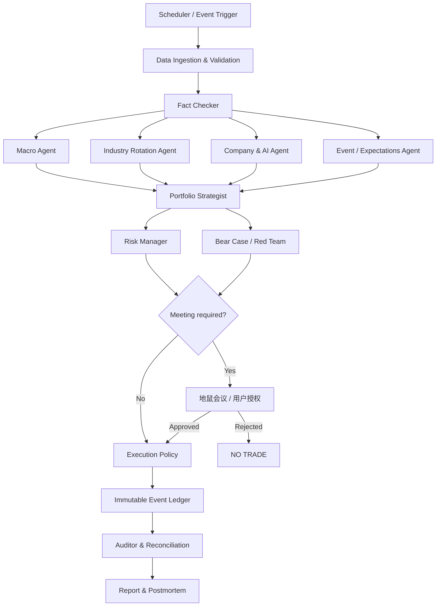
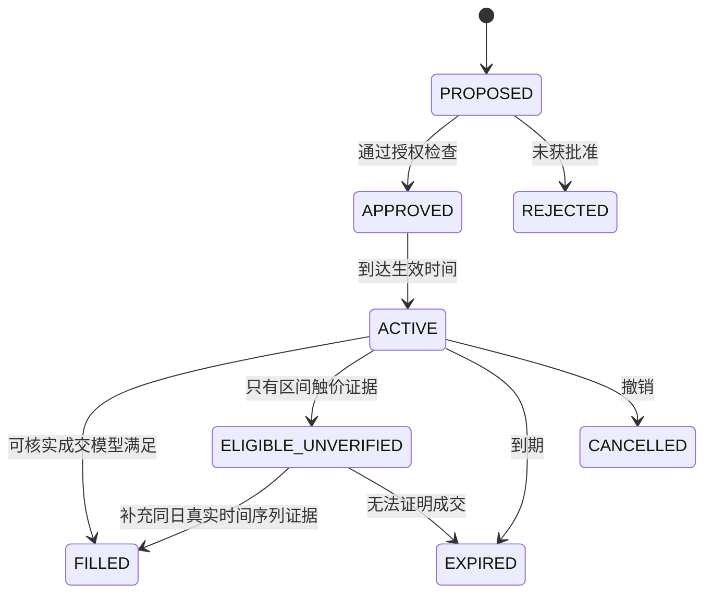

# 地鼠团队：可审计的多 Agent 投资决策系统

> Gopher Investment Agents (GIA) — Architecture, Implementation Specification & Historical Migration
>
> 版本：v1.0（2026-11-20）｜语言：中文｜目标：本地优先、模拟交易、可复现、可审计
>
> **重要：** 本文是软件系统与研究流程设计，不构成投资收益保证。系统默认仅进行虚拟交易，不连接真实券商、不自动下真实订单。

---

## 0. 执行摘要

我们从 2026-10-03 开始进行初始资金 **$100,000** 的美股虚拟挑战，以 **SPY 在 2026-10-02 的收盘价 $769.64** 为价格收益基准。最初约定期限一个月；之后的每日跟踪属于**延长观察期**，不得倒改原始挑战的截止日与成绩。历史上依次建立 SPY、QQQ、NVDA、BNO、XLE；随后减持能源及科技股；在用户授权的“地鼠会议”后，增持 XLI、XLF、XLV。最新**登记**的现金为 **$66,010.76**，而不是可自动认定为已由券商证实的现金。

系统的核心目标不只是生成“今天买什么”，而是构建一条可复现的因果链：

**信息时间 → 证据 → 假设 → 反方质询 → 风险检查 → 授权 → 预先锁定订单 → 可验证执行 → 不可变流水 → 事后复盘。**

系统必须同时回答：

1. 何时应该主动配置，而不是机械等待“确认”？
2. 哪些收益来自市场敞口、现金择时、行业选择、个股选择，哪些只是运气？
3. 如何避免未来信息泄漏、事后补记交易、价格来源冲突、LLM 编造事实？
4. 如何让用户只在真正重要的决策节点参与“地鼠会议”？

### 明确不做

- 不让 LLM 直接修改现金余额或持仓数量。
- 不把搜索结果或新闻摘要视作经过核实的成交价格。
- 不将日内最低价触及限价，直接等同于**已证实成交**；没有逐笔/分钟数据时只能标记 `eligible_unverified`。
- 不把模型预测当作已知市场事实；不把事件公布后的价格用于事件公布前的交易决策。
- 不因已有仓位或用户偏好而自动寻找支持性证据。
- 不承诺自动化能创造超额收益；需要严谨的样本外评估。

---

## 1. 我们已经学到的知识与经验

### 1.1 成功经验

| 经验 | 历史实例 | 系统化规则 |
|---|---|---|
| 现金本身是主动风险选择 | 约 67%–80% 现金在市场下跌时明显跑赢 SPY | 每日量化现金拖累/防御贡献、组合 beta 与上行机会成本 |
| 提前减仓比事后解释更有价值 | 10/19 执行 QQQ、NVDA 各减半 | 在催化剂前制定情景和退出条件，记录冻结时刻 |
| 行业不等于科技 | 后期引入 XLI、XLF、XLV | 研究覆盖科技、工业、医疗、金融、能源、消费、宽基及现金 |
| 相对收益与绝对收益是两件事 | 跑赢 SPY 时组合仍可能亏损 | 同时报绝对收益、相对收益、回撤和现金比例 |
| 用户判断应转化为可检验假设 | “近期不看好科技股” | 将观点写成期限、预期幅度、触发条件和失效条件 |
| 大决策需要讨论 | 约 $20k 非科技配置经地鼠会议批准 | 设置授权门槛和会议决议 ID |

### 1.2 失败与教训

| 问题 | 后果 | 工程改进 |
|---|---|---|
| 一直说“等消息公布再评估” | 失去事件前预期差机会 | 事件前必须输出有条件交易方案或明确无优势理由 |
| 频繁 HOLD、缺少主动候选 | 把默认现金当成理性策略 | HOLD 也要计算机会成本，并与备选配置对照 |
| 原油方向性预测失误 | BNO 提前退出，油价随后剧烈波动 | 明确失效阈值、概率校准、情景树，禁止事后改写观点 |
| 将“已知盘中最低价”当作限价单成交证据 | 模拟成交可信度不足 | 订单激活时间、可交易时段、逐笔/分钟数据、成交模型分级 |
| 不同报价源冲突 | 组合估值不确定 | 来源优先级、冲突阈值、复核与估值置信度 |
| 每日汇报使用极精确金额却缺少完整来源链 | 假精确、审计困难 | 每一价格、新闻、结论、成交都带原始来源和时间戳 |
| 宏观新闻可能被错误理解或转述 | 错误交易依据 | 事实核查 Agent + 原始公告优先 + 重大新闻二次核实 |
| 延长赛和原比赛混在一起 | 绩效口径漂移 | `competition_id`、固定起止时间、延长赛单独报告 |
| 行业轮动被事后识别 | 追买已上涨行业 | 使用事件前信号、滚动窗口和样本外验证 |

### 1.3 最重要的投资方法论

**主动配置 ≠ 高频交易。** 一个好的主动决策需要正的*预期风险调整后优势*，而不是只因为市场出现波动。系统必须能够给出 `BUY / SELL / HOLD / NO_TRADE`，并解释机会成本。

**判断正确 ≠ 交易正确。** 例如看空科技股后股价确实下跌，但若持有过多现金、其他行业跑赢，则组合未必跑赢 SPY。需要分离预测质量、仓位管理和执行质量。

**结果正确 ≠ 流程正确。** 即使某次“日内低点触及限价”的事后判定恰好有利，也不能自动证明订单在当时可成交。

---

## 2. 系统目标与指标

### 2.1 双重目标

1. **研究目标**：形成可证伪的投资假设，比较行业/公司/宏观风险，估计概率和不确定性。
2. **工程目标**：建立不会偷看未来、不会静默改账的自动决策与报告系统。

### 2.2 核心 KPI

- 组合净值 NAV、累计收益率、年化收益率（仅适当期限使用）、最大回撤、波动率、现金权重。
- 对 SPY 的累计超额收益（百分点和美元）、日度主动收益、跟踪误差、信息比率（样本足够时）。
- 资产、行业、现金、市场 beta 对收益的贡献。
- 预测概率校准：Brier score、log loss、分桶可靠性图。
- 决策质量：信号生成→审核→下单耗时；拒绝原因；错过机会的可解释性。
- 数据质量：价格来源冲突率、缺失率、时间戳完整率、可审计订单比例。
- 风险：单资产权重、行业集中度、预期短期损失、压力情景损失。

### 2.3 比赛制度不可变性

- 原始挑战：起始日期 2026-10-03；初始资金 $100,000；SPY 起点 2026-10-02 收盘价 $769.64。
- **原比赛截止时间尚需从原始规则/日志独立确认**，不得因后续延长观察而重新定义。
- 延长跟踪另建 `competition_id = gopher_extension_2026`，独立计量；不覆盖原始比赛结算。
- 默认仅多头、无杠杆、无期权、无做空；可使用小数份额的历史记录，未来订单采用明确的整股或小数份额规则。
- 成交手续费/滑点在历史中按零处理；未来仿真应增加可配置滑点和保守情景。

---

## 3. Agent 组织架构



### 3.1 Data Agent（行情与信息）

职责：获取并标记 **as-of 时间**的 OHLCV、盘前/盘后价格、公司行为、公告、财报、宏观数据、新闻。来源优先级：交易所/公司/监管/官方经济数据 → 可靠市场数据服务 → 次级行情服务 → 新闻转述。对同一字段的冲突，保存全部候选值而非覆盖。

输出：`MarketSnapshot`，含 `source_url`, `retrieved_at`, `published_at`, `market_session`, `adjustment_type`, `currency`, `quality_flag`。

### 3.2 Fact Checker（事实核验）

- 新闻事实、传闻、预测、观点分别打标签。
- 重大公司事件（CEO 离任、IPO、财报、监管）优先查官方披露；不能只凭单条新闻认定。
- 校验数据发布日历、时区、盘前/盘中/盘后与实际交易日。
- 冲突严重时返回 `INSUFFICIENT_EVIDENCE`，不允许 LLM 自行补齐数字。

### 3.3 Macro Agent（宏观）

关注：CPI、PPI、非农、失业率、ISM、FOMC、国债收益率、美元、油价、信用利差。每个事件存 `consensus_before_release`, `actual_after_release`, `surprise`, `release_timestamp`。**事件公布前的决策只能看到当时可得的共识，不得访问实际值。**

### 3.4 Industry Rotation Agent（行业轮动）

覆盖：SPY、RSP、QQQ、XLK、XLV、XLP、XLF、XLI、XLU、XLE、IWM 等。比较 1/5/10/20 日相对收益、成交量、波动率、趋势、行业广度、估值（有可靠数据时）。避免用当日上涨自动推导明日上涨。

### 3.5 Company & AI Agent（公司研究）

覆盖 NVDA、AMD、AVGO、MSFT、GOOGL、AMZN、META、PLTR 及 AI 云基础设施企业。分析：盈利预期、自由现金流、资本开支、融资结构、订单、竞争、监管与公司治理。区分 GPU 供应商、超大规模云平台、AI 云运营商和应用公司。

### 3.6 Event & Expectations Agent（预期差）

在财报/会议/IPO等事件**之前**生成情景树：

| 情景 | 概率（主观估计） | 资产回报假设 | 证据 | 失效条件 |
|---|---:|---:|---|---|
| 乐观 | p1 | r1 | ... | ... |
| 基准 | p2 | r2 | ... | ... |
| 悲观 | p3 | r3 | ... | ... |

其中 `p1+p2+p3=1`，`E[R] = Σ p_i*r_i`；必须记录估计时间、置信度与依据。概率不是客观事实，需要回测校准。若无可识别的预期差，应允许明确 NO_TRADE。

### 3.7 Portfolio Strategist（组合经理）

提出候选动作及替代方案：保持现金、买宽基、行业轮动、减仓集中风险。每项都计算对现金、beta、行业敞口、相对 SPY 的影响。必须至少提供 `do_nothing` 反事实。

### 3.8 Risk Manager（风险）

硬约束：

- 单一股票拟配置 **≥15% NAV** → 地鼠会议。
- 大幅改变现金比例（默认阈值建议 **≥15 个百分点**；具体阈值可配置）→ 地鼠会议。
- 新增总风险资金超出剩余批准预算 → 地鼠会议。
- 高集中度/杠杆/做空/期权/改变基准/改变比赛期限 → 需要额外明确批准或直接禁止。
- 对交易前后组合做 ±2%、±5%、±10% 市场情景与行业分化压力测试。

**注：** 15 个百分点是工程默认建议，不应伪称历史上已有该精确硬阈值；历史会议原则是重大变化必须协商。

### 3.9 Red Team（反方）

对每笔建议提出至少三项质疑：

1. 哪个关键事实若错误会推翻交易？
2. 这个优势是否已被市场价格反映？
3. 是否只是因为昨日涨跌、当前持仓或用户观点而形成确认偏误？

反方必须能输出 `VETO_RECOMMENDED`，但不直接修改仓位。

### 3.10 Execution Agent（执行）

仅消费经过授权且冻结的 `OrderIntent`。不得生成新的投资理由或更改订单参数。虚拟成交按明确的时间顺序和保守成交模型判定，所有结果写入事件日志。

### 3.11 Auditor（审计）

独立于策略与执行 Agent；只读原始日志、重新计算现金/仓位/NAV、对比来源和权限。审计失败时阻止发布“正式净值”，只允许“暂估”。

### 3.12 Reporter（报告）

输出中文日报：检查时点、最新可核实行情、组合与 SPY、当日变动、风险、建议操作、订单状态、会议触发、审计异常。明确区分正式收盘估值与盘中参考估值。

---

## 4. 权限与“地鼠会议”

### 4.1 权限矩阵

| 动作 | AI 可自主执行 | 用户批准后 |
|---|---|---|
| 获取数据、分析、提出交易方案 | 是 | 不需要 |
| 日常 HOLD、风险提醒 | 是 | 不需要 |
| 已批准预算内且规则预先冻结的模拟交易 | 是，依规则 | 先有有效授权 |
| 新增大额配置或超预算 | 否 | 必须 |
| 单一股票权重 ≥15% | 否 | 必须 |
| 显著改变现金比例 | 否 | 必须 |
| 修改历史交易、追溯改价 | **永远不允许** | 用户也不能改写历史，只能追加更正事件 |
| 真实券商下单 | **默认禁止** | 未来另行设计独立审批与安全控制 |

### 4.2 会议流程

1. Strategist 提案，列出 A/B/C 和“不交易”。
2. Macro/Industry/Company 给出支持证据。
3. Red Team 反驳。
4. Risk Manager 给出仓位、回撤和授权判断。
5. Reporter 生成简短会议纪要。
6. 用户明确批准具体额度、标的、有效期和执行规则。
7. 系统创建不可变 `ApprovalEvent`；之后才能创建 `OrderIntent`。

**用户说“支持”**：只有在上下文中有唯一、具体的提案时才视作批准；否则要求确认。批准的额度与执行规则必须存入结构化记录，不能只靠 LLM 记忆。

---

## 5. 数据与存储设计

### 5.1 技术选型（本地优先）

- Python 3.12+；`pydantic` 校验 schema。
- DuckDB + Parquet 存历史行情与研究特征；SQLite（WAL）或 PostgreSQL 存交易事件与权限。
- `pandas` / `polars` 处理行情；`numpy`, `scipy`, `statsmodels` 用于统计。
- `FastAPI` 提供 API；`Streamlit` 或 `React + FastAPI` 做中文面板。
- `APScheduler` / cron 定时；`pytest` + `hypothesis` 测试。
- 多 Agent 可先用**普通 Python 状态机**实现，再按需使用 LangGraph；不要一开始引入过多框架。
- LLM 接口采用 provider-agnostic adapter；可连接本地模型或外部模型。API 密钥用环境变量/密钥管理，不写入日志。

### 5.2 推荐目录结构

```text
gopher-agents/
├── README.md
├── pyproject.toml
├── .env.example
├── config/
│   ├── competition.yaml
│   ├── risk_limits.yaml
│   ├── data_sources.yaml
│   └── agents.yaml
├── data/
│   ├── raw/                 # 原始来源快照，不覆盖
│   ├── normalized/          # 清洗行情
│   └── imports/             # 历史交易导入
├── src/gopher/
│   ├── schemas.py
│   ├── clock.py
│   ├── ingestion.py
│   ├── validation.py
│   ├── event_store.py
│   ├── ledger.py
│   ├── valuation.py
│   ├── benchmark.py
│   ├── risk.py
│   ├── approvals.py
│   ├── execution.py
│   ├── reporting.py
│   ├── backtest.py
│   ├── api.py
│   └── agents/
│       ├── macro.py
│       ├── rotation.py
│       ├── company.py
│       ├── expectations.py
│       ├── strategist.py
│       ├── red_team.py
│       └── auditor.py
├── prompts/
│   ├── strategist.md
│   ├── red_team.md
│   └── reporter.md
├── tests/
│   ├── test_ledger.py
│   ├── test_no_lookahead.py
│   ├── test_approvals.py
│   ├── test_limit_orders.py
│   └── test_benchmark.py
└── reports/
    └── YYYY-MM-DD/
```

### 5.3 核心对象

```python
from datetime import datetime
from decimal import Decimal
from typing import Literal
from pydantic import BaseModel, Field

class Evidence(BaseModel):
    evidence_id: str
    source_url: str
    retrieved_at: datetime
    published_at: datetime | None = None
    available_at: datetime   # 决策时首次可得时间
    source_type: Literal['exchange','filing','official','vendor','news','derived']
    reliability: Literal['verified','provisional','disputed']
    content_hash: str

class Decision(BaseModel):
    decision_id: str
    competition_id: str
    decided_at: datetime
    data_cutoff: datetime
    action: Literal['BUY','SELL','HOLD','NO_TRADE']
    ticker: str | None = None
    thesis: str
    evidence_ids: list[str]
    invalidation_conditions: list[str]
    approval_id: str | None = None

class OrderIntent(BaseModel):
    order_id: str
    decision_id: str
    created_at: datetime
    effective_from: datetime
    expires_at: datetime
    ticker: str
    side: Literal['BUY','SELL']
    quantity: Decimal = Field(gt=0)
    order_type: Literal['LIMIT','MARKET']
    limit_price: Decimal | None = None
    approval_id: str | None = None
    status: Literal['PENDING','ACTIVE','EXPIRED','CANCELLED','FILLED','ELIGIBLE_UNVERIFIED']

class FillEvent(BaseModel):
    fill_id: str
    order_id: str
    filled_at: datetime
    price: Decimal
    quantity: Decimal
    fee: Decimal = Decimal('0')
    source_evidence_id: str
    execution_model: str
```

所有金额使用 `Decimal`，时区使用带偏移的时间戳，统一存 UTC；显示时再转换 `America/New_York` 和 `Europe/Berlin`。避免用浮点数累积账本误差。

### 5.4 事件溯源（Event Sourcing）

账本不能保存一个可随意编辑的 `cash = 66010.76` 作为唯一真相。应保存：

- `CompetitionCreated`
- `OrderProposed`
- `ApprovalGranted` / `ApprovalRejected`
- `OrderActivated` / `OrderExpired` / `OrderCancelled`
- `FillRecorded`
- `CorporateActionRecorded`
- `CorrectionAppended`（仅追加，不覆盖原事件）
- `ValuationPublished`
- `AuditFlagRaised` / `AuditResolved`

现金和持仓通过**按顺序重放事件**得到。每个事件含 `event_id`, `occurred_at`, `recorded_at`, `source`, `prev_hash`, `event_hash`，形成哈希链。哈希链只能提供篡改可检测性，不等于外部公证；需要定期将快照备份到独立位置。

---

## 6. 历史交易迁移（重要）

**迁移原则：** 以下是从对话中恢复的**登记模拟账本**，不是独立券商成交证明。不得根据新行情覆盖原来的模拟成交价。必须把“原登记值”与“外部市场核验值”分开存储。

### 6.1 不可变历史流水

| 日期（美东） | 交易 | 登记数量 | 登记价格 | 登记现金变化/结果 |
|---|---|---:|---:|---|
| 2026-10-03 | 初始资金 | — | — | $100,000.00 |
| 2026-10-06 | 买 SPY | 12.850990 | $778.15 | 投入 $10,000 |
| 2026-10-06 | 买 QQQ | 10.519120 | $760.52 | 投入 $8,000 |
| 2026-10-06 | 买 NVDA | 28.913670 | $242.10 | 投入 $7,000；现金 $75,000 |
| 2026-10-09 | 买 BNO | 94.741829 | $63.33 | 投入 $6,000 |
| 2026-10-09 | 买 XLE | 92.307692 | $65.00 | 投入 $6,000；现金 $63,000 |
| 2026-10-12 | 卖 BNO 全部 | 94.741829 | $65.50 | 登记收入 $6,205.59 |
| 2026-10-12 | 卖 XLE 一半 | 46.153846 | $65.85 | 登记收入 $3,039.23；现金 $72,244.82 |
| 2026-10-19 | 卖 QQQ 一半 | 5.259560 | $719.66 | 登记收入 $3,785.09 |
| 2026-10-19 | 卖 NVDA 一半 | 14.456835 | $218.01 | 登记收入 $3,151.73；现金 $79,181.65 |
| 2026-10-30 | 买 XLI | 23 | $170.13 | 登记支出 $3,912.99 |
| 2026-10-30 | 买 XLF | 43 | $56.94 | 登记支出 $2,448.42；现金 $72,820.24 |
| 2026-11-02 | 买 XLV | 37 | $184.04 | 登记支出 $6,809.48；现金 $66,010.76 |

**核验注意事项：**

- 10/09 BNO/XLE 开盘价在后续来源出现过不同数值；保持原登记成交价并增加 `PRICE_CONFLICT` 标记。
- 10/19 两笔登记收入 $3,785.09 + $3,151.73 = $6,936.82，而后续现金账本按约 $6,936.83 增加；存在 **$0.01 登记舍入差异**。应记录 `ROUNDING_RECONCILIATION`，不可静默改写任一交易。
- 10/30 XLI/XLF 和 11/02 XLV 属于**事后基于预设限价与行情区间推定的模拟成交**；不是券商逐笔确认。需要存 `fill_confidence = provisional`，并保留原始判定方法和来源。
- 10/30 原始模拟规则称订单在09:43 ET后生效。**仅有全天最低价低于限价，不能证明最低价发生于09:43之后。** XLI曾有较晚时点价格支持，XLF需要进一步核验精确触价时间。原记录不撤销，但审计标记保持开放。
- 11/02 XLV 日内最低价低于限价，但若没有精确时间及交易量，仍是 `provisional` 模拟成交。
- 历史数量与金额可能因小数份额截断产生美分差异，保留原始入账值和计算差异，后续只追加对账调整事件（须标明来源和原因）。

### 6.2 最新登记持仓快照（2026-11-19 收盘之后，2026-11-20 报告所用）

| 资产 | 数量 |
|---|---:|
| SPY | 12.850990 |
| QQQ | 5.259560 |
| NVDA | 14.456835 |
| XLE | 46.153846 |
| XLI | 23 |
| XLF | 43 |
| XLV | 37 |
| BNO | 0 |
| **现金** | **$66,010.76** |

2026-11-20 上一次**报告登记**的 2026-11-19 收盘组合净值为 **$96,190.98**、SPY 基准 **$93,013.62**、相对领先 **$3,177.36**。这些数字是**历史报告快照，尚待独立行情源与逐笔流水审计**，不可直接标记为外部已验证事实。

### 6.3 必须保留的历史审批

- 10/08 地鼠会议：批准 10/09 BNO $6k + XLE $6k。
- 10/11 预设 10/12 卖 BNO 全部、XLE 一半。
- 10/16 地鼠会议：批准 10/19 QQQ、NVDA 各卖出一半。
- 10/29–10/30 用户明确支持非科技配置：XLI 上限 $8k、XLV $7k、XLF $5k，合计 $20k；后续分批规则和限价被记录。
- 此后提出过多次再部署 $10k–$20k 的会议**建议**，但没有自动形成新的授权。

---

## 7. 模拟执行引擎：必须避免“事后成交”

### 7.1 订单状态机



### 7.2 数据证据等级

1. **A 级**：券商成交回报（真实交易场景）或可信逐笔历史成交 + 时间戳 + 可执行模型。
2. **B 级**：分钟 OHLCV + 订单生效时间 + 保守成交规则（仍为仿真）。
3. **C 级**：日 OHLC，仅能说明某个价位**可能**触及，不能证明订单生效后触及，更不能证明排队成交。
4. **D 级**：新闻、搜索摘要、非同步快照；只用于分析，不用于确认成交。

### 7.3 限价买入保守规则

- 订单必须在 `effective_from` 后才可能成交。
- 买入限价 `L`：若后续可信时间序列出现 `trade_price <= L`，且满足交易量/时段条件，可按 `L` 或更保守模型价模拟成交；不因事后看到更低收盘价而自动获得更好价格。
- 若仅有全日最低价低于 `L`，而订单生效时间在开盘之后，标记 `ELIGIBLE_UNVERIFIED`，不能正式 `FILLED`。
- 当日有效订单在当日16:00 ET后到期；不自动滚动到下一日。
- 对涨跌停、停牌、拆股、分红、盘前/盘后限制进行独立检查。
- 历史已登记的模拟成交不静默删除；审计标记与更正事件分开存放。

### 7.4 时间规则

- 所有决策使用 `data_cutoff <= decided_at`。
- 每条证据要求 `available_at <= data_cutoff`；数据发布与数据被实际抓取是两个不同时间。
- 回测必须使用 point-in-time 数据（当时的指数成分、财报预期、公司行为），不能偷看未来修订。
- 德国与美国夏令时切换日期不同；统一按 IANA 时区计算，不写死“美股开盘总是德国15:30”。

---

## 8. 组合会计、基准与绩效归因

### 8.1 账本重放

```python
from decimal import Decimal

cash = Decimal('100000.00')
positions = {}
for event in immutable_events_sorted_by_sequence:
    if event.type == 'FillRecorded':
        signed_qty = event.quantity if event.side == 'BUY' else -event.quantity
        positions[event.ticker] = positions.get(event.ticker, Decimal('0')) + signed_qty
        cash -= signed_qty * event.price
        cash -= event.fee
    elif event.type == 'CashAdjustmentRecorded':
        cash += event.amount

nav = cash + sum(qty * verified_close[ticker] for ticker, qty in positions.items())
```

历史迁移可使用原登记现金变化事件处理舍入差异，但必须显示“由逐笔价格推导的现金”和“原登记现金”之间的 reconciliation。

### 8.2 SPY 基准

```text
spy_units = 100000 / 769.64
spy_nav_t = spy_units * spy_close_t
absolute_return = portfolio_nav_t / 100000 - 1
benchmark_return = spy_close_t / 769.64 - 1
active_return_pp = 100 * (absolute_return - benchmark_return)
active_pnl_usd = portfolio_nav_t - spy_nav_t
```

该公式是**价格收益**比较，不包含 SPY 分红再投资；如将来改为总回报，必须另建基准版本，不覆盖历史结果。

### 8.3 收益归因

至少拆分：

- **现金效应**：低市场敞口在上涨/下跌行情中带来的相对表现。
- **市场 beta**：持仓对 SPY 的系统性暴露。
- **行业效应**：XLE/XLI/XLF/XLV 等相对市场的贡献。
- **个股效应**：NVDA 与 QQQ 重叠敞口等。
- **交易时机效应**：减仓或增仓相对保持原仓的反事实差异。
- **执行效应**：计划价、可验证成交价、滑点与未成交机会成本。

禁止把“如果没减仓会亏更多”直接表述为已经赚到的钱；只能作为反事实风险比较。

---

## 9. 每日运行流程

### 9.1 盘前（美东 08:30–09:20，按交易日）

1. 锁定检查时间、可用信息截止时间。
2. 复核上一交易日收盘价、公司行为、现金与持仓。
3. 抓取当天已经发布的宏观数据、财报和可信新闻。
4. 各研究 Agent 输出机会、风险、情景概率。
5. Strategist 提出最多三项候选交易 + HOLD。
6. Red Team 反驳；Risk Manager 检查。
7. 若需会议则请求用户授权；否则按既有权限生成订单意向。
8. 冻结订单参数并写日志。

### 9.2 盘中

- 仅按事先冻结的订单执行；若出现重大新事实，可创建**新的、带时间戳的决策事件**，不得覆盖原决策。
- 行情缺失或冲突时暂停确认成交。
- 不在日后用盘中极值倒填过去没有生效的订单。

### 9.3 收盘后

- 对账订单、成交、现金、持仓、价格。
- 计算 NAV 与 SPY 差额。
- 更新预测评分、机会成本、失效假设。
- 输出日报并存档 `report_hash`。

### 9.4 周末

- 生成周报、风险暴露、错误归因、研究候选池。
- 不因为周末新信息而改写周五收盘时的决策依据。
- 如需要周一订单，明确有效期与激活时间；不能默认周末“计划”已执行。

---

## 10. 推荐的 LLM 提示词（最小可用版）

### Strategist 系统提示词

```text
你是地鼠团队的投资组合研究 Agent。你只可使用输入中 available_at 不晚于 data_cutoff 的证据。
你必须给出：市场状态、至少一个主动交易候选、HOLD 对照、风险、预期差、失效条件。
不能编造价格、新闻、成交、概率来源或用户授权。
不能直接修改持仓与现金。输出必须符合 DecisionProposal JSON Schema。
若没有优势，输出 NO_TRADE，并量化现金机会成本。
```

### Red Team 系统提示词

```text
你是独立反方。目标不是支持组合经理，而是找出事实错误、未来信息泄漏、过拟合、追涨、
行业相关性、过度现金、仓位重叠和不可执行订单。
对每个提案给出最强反驳、证据缺口、可能推翻它的观察结果和是否建议否决。
不能修改交易记录。
```

### Auditor 系统提示词

```text
你是审计 Agent。只依据不可变事件日志和可核实行情重新计算仓位、现金、NAV、基准。
区分登记成交、仿真推定成交和外部确认成交。
如发现价格冲突、日期冲突、现金差异、缺失授权或未来信息，标记异常并阻止正式发布。
绝不静默修正历史事件；只能建议追加更正记录。
```

### Reporter 系统提示词

```text
你生成简洁中文日报，包含：检查时点、正式估值日、组合持仓和现金、SPY对比、
当日已知市场事实、拟采取操作、执行状态、会议要求、审计异常。
所有行情标注来源及时间；对无法核实的价格明确写“暂估”或“未核实”。
不得把提案写成已成交，不得将反事实收益写成已实现利润。
```

---

## 11. API 与交互界面

### 11.1 最小 API

| Endpoint | 作用 |
|---|---|
| `GET /portfolio?as_of=...` | 按指定时间重放账本 |
| `GET /performance?competition_id=...` | 绝对/相对 SPY 绩效 |
| `GET /evidence/{id}` | 原始证据与时间戳 |
| `POST /research/run` | 运行研究 Agent |
| `POST /decisions/propose` | 生成交易建议 |
| `POST /meetings` | 创建地鼠会议 |
| `POST /meetings/{id}/approve` | 用户批准结构化方案 |
| `POST /orders` | 经授权创建冻结订单 |
| `POST /execution/reconcile` | 根据行情核验订单 |
| `GET /audit` | 异常与对账状态 |
| `GET /reports/daily` | 中文日报 |

### 11.2 UI 页面

1. **战情室**：NAV、SPY、相对收益、现金、持仓、最新风险。
2. **研究雷达**：行业强弱、事件日历、候选交易与证据。
3. **地鼠会议**：正方/反方、情景、投票、用户授权。
4. **交易台**：订单状态、限价、有效期、成交证据等级。
5. **审计室**：事件哈希链、价格冲突、现金差异、未来信息检查。
6. **复盘室**：预测校准、反事实、错误分类、经验库。

---

## 12. 必须通过的测试

### 12.1 不可变账本

- 重放全部历史事件应得到已登记现金 **$66,010.76** 与七只持仓数量。
- 更改历史事件任何一个字符应触发哈希/审计异常。
- 10/19 的 1 美分差异应显示而非自动消失。

### 12.2 防未来信息泄漏

- 11/17 财报公布前的决策无法访问公布后的财报数字。
- 11/19 IPO 首日开盘前无法访问首日收盘价。
- 11/02 开盘前无法访问当日最低价。
- 回测查询必须基于 `available_at` 而非当前数据库的最新值。

### 12.3 订单执行

- 09:43 激活的订单，不得使用09:30–09:42的最低价确认成交。
- 仅有日内 low <= limit 时不得自动标记 `FILLED`。
- 到期订单不得次日自动复活。
- 无审批的超预算订单必须拒绝。

### 12.4 风险与授权

- 单一股票拟达到 15% NAV，必须触发会议。
- 现金目标变化超过配置阈值，必须触发会议。
- 已批准$20k预算不得超额使用。
- 用户拒绝后不能创建 ACTIVE 订单。

### 12.5 数据质量

- 两个行情源收盘价差异超过可配置阈值时，正式净值暂停发布。
- 公司拆股前后应使用一致的价格/数量口径。
- 美股节假日、德国/美国夏令时差异正确处理。
- 价格数据不能混用 adjusted close 与 unadjusted close 而不说明。

---

## 13. 实现路线图（以验收标准为核心）

### Phase 0：冻结历史与证据（最重要）

- 导出本文件第6节历史流水为 CSV/JSON。
- 导入原始对话记录、交易批准消息、行情来源及报告快照。
- 标记每笔交易的来源与可信等级。
- **验收：** 现金与仓位可重放；所有差异可见；原比赛截止日期明确。

### Phase 1：无 LLM 的可靠内核

- 实现事件日志、现金/持仓、SPY 基准、风险阈值、限价订单状态机。
- **验收：** 第12节会计、授权、执行测试全部通过。

### Phase 2：数据管线与核验

- 接入授权的数据服务；抓取官方公告、财报和经济日历。
- 建立数据快照、时间戳、来源冲突检测。
- **验收：** 可以回放任意交易日当时实际可得的信息。

### Phase 3：多 Agent 研究与会议

- 先实现 Strategist、Red Team、Risk、Auditor 四个 Agent；再增加 Macro/Industry/Company。
- **验收：** 重大交易无法绕过会议，研究结论可追溯至证据。

### Phase 4：回测与影子运行

- 先做 walk-forward backtest，再与不交易、满仓 SPY、固定股债/现金组合比较。
- 运行至少数周**影子模式**：Agent 提议，但不自动记成交。
- **验收：** 无时间泄漏；成交模型可信；预测评分与风险表现可复核。

### Phase 5：自动日报与交互式工作台

- 每个美股交易日自动运行盘前、盘后流程；周末复盘。
- **验收：** 用户可一键查看“为什么买、何时批准、如何成交、何处有证据”。

**建议先完成 Phase 0–2，再让 Agent 参与模拟执行。** 研究质量再高，也不能弥补账本不可靠。

---

## 14. 一个完整的未来决策示例（虚构情景，不是实际交易）

```yaml
competition_id: gopher_extension_2026
decision_id: example_001
as_of: '2026-12-01T13:00:00Z'
asset: XLV
proposal: BUY
budget_usd: 3000
thesis: '医疗相对强度改善，且预期收益高于继续持有现金'
evidence_ids: ['example_evidence_a', 'example_evidence_b']
scenarios:
  bull: {probability: 0.30, return_pct: 4.0}
  base: {probability: 0.45, return_pct: 1.0}
  bear: {probability: 0.25, return_pct: -5.0}
expected_return_pct: 0.40
red_team: '优势较小，可能不足以覆盖模型误差与滑点'
risk_check: '预算内；未触发集中度限制'
approval: '需检查现有授权是否覆盖该日期与金额'
order: '仅在授权后创建，禁止回填'
```

示例中的概率、日期和预期收益均为教学假设，不是实际市场预测。

---

## 15. 未来如何形成真正的方法学优势

**方向 A：预测与执行解耦。** 研究 Agent 输出概率分布，执行内核不读取自由文本建议，只读取结构化、经审计的订单。这样即使模型升级，交易规则仍可复现。

**方向 B：把“没有交易”当作可评价的决策。** 为 HOLD 记录当时最好的替代方案及其风险，避免模型因为少交易而看起来永远正确。

**方向 C：自动化反事实实验。** 对每次减仓、增仓、现金保留计算“保持原仓”“满仓 SPY”“等权行业配置”等反事实，但不把反事实计入真实账本。

**方向 D：建立可校准的事件预测数据库。** 所有财报、CPI、FOMC 等事件前预测先冻结，再计算概率校准和收益归因，避免事后故事化。

**方向 E：LLM 与数值模型分工。** LLM 用于解释、假设生成、证据审查；统计模型负责回测、收益分布、组合优化；确定性代码负责交易、现金、审计。不要让 LLM 同时扮演会计、券商和新闻来源。

**方向 F：多 Agent 的价值必须经过消融实验验证。** 对比单 Agent、加 Red Team、加风险门控、完整多 Agent 的表现，控制相同数据、交易成本和决策次数。不能仅凭多 Agent 辩论更热闹就认为有投资优势。

---

## 16. 首次开发的具体任务清单

- [ ] 确认原始比赛正式结束时间与最终结果；建立独立延长赛 ID。
- [ ] 将第6节交易记录转换成不可变事件文件。
- [ ] 导入并归档各次地鼠会议批准记录。
- [ ] 对 10/09、10/19、10/30、11/02 的价格与成交证据打审计标签。
- [ ] 实现 `Decimal` 现金/持仓重放与差异报告。
- [ ] 实现 SPY 基准价格收益核算。
- [ ] 实现带 `available_at` 的行情与新闻快照。
- [ ] 实现严格的限价订单状态机。
- [ ] 实现风险阈值和用户授权 API。
- [ ] 实现 Strategist + Red Team + Auditor 的最小多 Agent 工作流。
- [ ] 加入行业轮动与事件前预期差研究。
- [ ] 完成 no-lookahead 单元测试与历史回放。
- [ ] 输出第一份完整、可复核的中文日报。

---

## 17. 最终设计原则

> **大胆提出假设，保守认定事实；主动配置风险，严格控制权限；允许预测错误，绝不允许事后改账。**

地鼠团队真正值得产品化的，不是某一天赢了 SPY，而是这套从**信息 → 判断 → 授权 → 执行 → 审计 → 学习**的闭环。它既能作为家庭投资研究游戏，也能作为可展示的 AI Agent 工程项目。若未来用于真实资金，必须另行增加券商权限隔离、合规、安全、失败回滚和人工最终确认机制。
