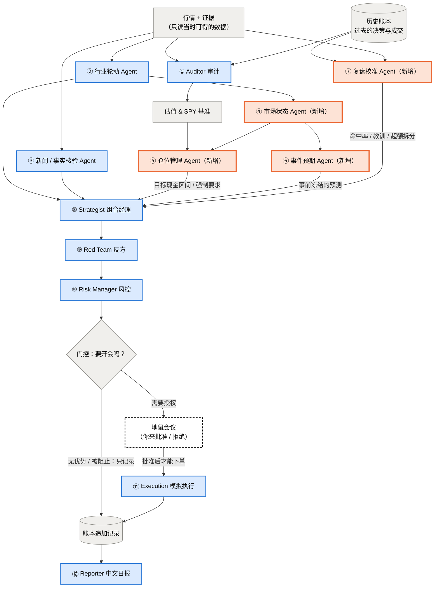

# 地鼠团队 Gopher Investment Agents (GIA)

一个**可审计的多 Agent 美股投资研究系统**。它每天读行情、分析市场、提出买卖建议，并跟 SPY 比成绩。
任何交易都要你在“地鼠会议”上亲自批准。所有记录写进不可篡改的账本，事后可以逐条复盘。

> ⚠️ **仅模拟交易**：不连接券商，不下真实订单，不构成投资建议。
>
> 大胆提出假设，保守认定事实；主动配置风险，严格控制权限；允许预测错误，绝不允许事后改账。

**目录**
- [第一个月战绩：地鼠 vs SPY](#第一个月战绩地鼠-vs-spy2026-10-02--11-19)
- [Agent 架构](#agent-架构)
- [新手使用指南（一步一步）](#新手使用指南一步一步)
- [命令速查表](#命令速查表)
- [常见问题](#常见问题)
- [设计要点](#设计要点) · [目录结构](#目录结构) · [尚未实现](#尚未实现--待确认)

## 第一个月战绩：地鼠 vs SPY（2026-10-02 → 11-19）


| 截至 2026-11-19 收盘 | 数值 |
|---|---:|
| 地鼠组合净值 | **$96,190.98**（-3.81%） |
| SPY 基准净值（10/02 收盘 $769.64 等额买入） | $93,013.62（-6.99%） |
| 相对 SPY | **+$3,177.36 / +3.18pp** |
| 现金 | $66,010.76（占净值 68.6%） |
| 最大回撤，10/16–11/19 | 组合 -3.12% / SPY -7.40% |
| 日收益对 SPY 的 beta（10/16–11/19，24 个交易日） | 约 0.29（相关系数 0.97） |

| 阶段 | 日期 | 跑赢 SPY 的天数 | 超额区间 | 阶段末超额 |
|---|---|---:|---:|---:|
| 建仓期（独立重建） | 10/02–10/15 | 0 / 9 | -$1,553 ~ $0 | -$1,105 |
| 原比赛 | 10/16–11/02 | 3 / 12 | -$1,163 ~ +$771 | +$771 |
| 延长跟踪 | 11/03–11/19 | 10 / 13 | -$841 ~ +$3,177 | +$3,177 |

原比赛的正式终点没有锁定记录，图中 11/02 的分隔线只是参考，不代表审定后的赛果。

> 最新（系统独立计算，不在原始文件里）：11/20 收盘组合 $95,184.12，SPY 基准 $89,627.62，领先 **$5,556.50（+5.56pp）**。

**怎么看这份成绩**

- **领先完全来自低敞口，选股其实在拖后腿。** 组合 beta 只有约 0.29，现金一直在 63%–80%。复盘校准 Agent 把 +$3,177 的超额拆开：
  - **敞口效应 +$4,583**：平均 74% 现金，SPY 跌的时候少亏；
  - **敞口之外 -$1,406**：同样的现金比例，如果其余部分全放 SPY，会比实际多 $1,406。也就是说 QQQ、NVDA、BNO/XLE、XLI/XLF/XLV 这些具体选择合计跑输了 SPY。
  - 所以 SPY 大跌的日子跌得少（11/05 组合 -1.45%，SPY -4.41%），大涨的日子也涨得少（11/04 组合 +0.21%，SPY +1.65%）。
- **前两周其实一直落后。** 10/06 建仓后，SPY 先涨后跌，组合最多落后 $1,553（10/09）。10/23 才第一次短暂反超。
- **10/19 减半 QQQ、NVDA 是最有价值的一次操作**：和“那天不减仓”的反事实相比，截至 11/19 多保住约 $1,434。10/12 卖出 BNO、XLE 也比不卖好约 $860。这些都是反事实比较，不能当成已经赚到的钱。
- **10/30–11/02 加了 XLI、XLF、XLV**（经地鼠会议授权，上限 $20k，实际用了 $13,170.89）。之后三只都跌了：截至 11/19，按平均成本算合计浮亏约 $504。
- **绝对收益仍是负的。** 跑赢 SPY 和赚钱是两回事（文档 §1.1）。

**数据核验**（`gopher verify` + 独立行情重算）

- 用事件日志重放持仓，再乘 yfinance 未复权收盘价，跟原日报逐日比对：
  - 25 个交易日的 SPY 收盘价和现金余额，**全部一致**；
  - 组合净值 **24/25 天精确到美分**；
  - 只有 11/04 差 $0.92：原日报 $98,790.84，重算 $98,789.92。原因待查，原记录保留不改。
- 10/02–10/15 原日报没有逐日净值。表和图里这段是用同样方法**独立重建**的，单独存放，标注为重建，不冒充当时的日报。
- 10/30 XLI/XLF 和 11/02 XLV 的三笔买入，是按事前限价规则事后判定的模拟成交，缺少逐笔证据，状态为 `provisional`（见审计告警）。

**历史文件**（`docs/history/`）

| 文件 | 内容 |
|---|---|
| `Gopher_Daily_Performance.csv` | 10/16–11/19 原日报登记的每日净值、SPY 基准、超额、现金 |
| `Gopher_Reconstructed_2026-10-02_to_10-15.csv` | 10/02–10/15 独立重建（事件日志重放 × yfinance 收盘价） |
| `Gopher_Trade_Ledger.csv` | 12 笔原始模拟交易（与 `data/imports/history_2026.csv` 一致） |
| `Gopher_Performance_Analysis.md` | 原始成绩分析、策略演化与审计限制说明 |
| `Gopher_Performance_Dashboard.html` | 离线交互式图表（下载后用浏览器打开） |
| `gopher_vs_spy.svg` | 上面这张图 |

## Agent 架构

一共 **12 个 Agent**。**蓝色**是第一版就有的，**橙色**是第二版新增的四个辅助策略 Agent，灰色是基础设施，虚线框是你本人。



图例：🟦 原有 Agent · 🟧 新增 Agent · ⬜ 基础设施（数据、估值、账本、门控）· ⬚ 虚线框 = 你

### 为什么加这四个 Agent

第一个月的复盘暴露了四个问题，原有的 Agent 都管不到：

| 问题 | 证据 | 新增的 Agent |
|---|---|---|
| 不知道现在该进攻还是防守 | Strategist 只看单个标的的强弱，没有人对整个市场下结论 | ④ **市场状态 Agent** |
| 现金多少全靠惯性 | 10/06 只投了 25%，之后多次提议再部署都没执行；现金一直在 63%–80%，没有任何目标 | ⑤ **仓位管理 Agent** |
| 总是“等消息出来再说” | 文档 §1.2 的头号教训：错过事件前的预期差；事后也无法检验当时判断准不准 | ⑥ **事件预期 Agent** |
| 赢了也不知道为什么赢 | 跑赢 SPY 到底是选股好还是现金多？没人算过 | ⑦ **复盘校准 Agent** |

它们插在研究层，结论汇总到 Strategist；Strategist 之后的反方、风控、会议、执行流程**完全不变**。也就是说，新 Agent 只能“提要求、给信息、补候选”，**不能绕过地鼠会议**。

### 每个 Agent 做什么

“确定性”指纯代码计算，同样的输入永远得到同样的结果。“LLM”指调用 Claude，没有凭证时自动换成确定性规则版本。

#### 🟦 原有 Agent

| # | Agent | 类型 | 做什么 | 输出 | 能否改仓位 |
|---|---|---|---|---|---|
| ① | **Auditor 审计** | 确定性 | 校验账本哈希链，重放现金与持仓，跟登记快照对账，检查授权是否超额、有没有未来信息 | 通过 / 未通过 + 告警清单。未通过时净值只能标“暂估” | 否 |
| ② | **行业轮动 Agent** | 确定性 | 计算 SPY、QQQ、XLK、XLV、XLF、XLI、XLE、XLU、XLP、IWM、RSP、NVDA 等的 1/5/10/20 日收益、相对 SPY 强弱、波动率、是否在 20 日均线上方 | 行业轮动雷达表 | 否 |
| ③ | **新闻 / 事实核验 Agent** | LLM + 联网搜索 | 只在 `--web` 时运行。检索宏观、财报、公司公告，标注事实 / 传闻 / 预测 / 观点；**URL 不在真实搜索结果里的一律丢弃** | 证据库条目（provisional） | 否 |
| ⑧ | **Strategist 组合经理** | LLM / 规则 | 汇总所有 Agent 的信息，提出最多 3 个买卖候选 + “什么都不做”的对照；每个候选必须有 bull/base/bear 情景、概率、失效条件和证据 ID | 候选方案。期望收益由代码重算，引用不存在的证据会被剔除 | 否，只提议 |
| ⑨ | **Red Team 反方** | LLM / 规则 | 对每个候选至少提 3 个质疑：关键事实错了怎么办？是否已经被价格反映？是不是追涨或确认偏误？ | PROCEED / 谨慎 / **建议否决** | 否，可建议否决 |
| ⑩ | **Risk Manager 风控** | 确定性 | 检查现金够不够、是否做空、单股是否 ≥15% NAV、现金比例变化是否 ≥15pp、有没有覆盖的授权；做 ±2/5/10% 压力测试 | 硬阻止 / 会议触发条件 | 否，可阻止 |
| ⑪ | **Execution 模拟执行** | 确定性 | 只执行已批准并冻结的订单；按分钟线保守判定成交，只有日线证据时标“待核实” | 成交 / 待核实 / 过期记录 | 只按冻结订单执行 |
| ⑫ | **Reporter 中文日报** | 确定性 | 把以上所有结果写成日报，区分“正式估值”和“暂估”、“提案”和“成交” | `reports/日期/daily_report_HHMM.md` | 否 |

#### 🟧 新增 Agent

**④ 市场状态 Agent**（确定性，`src/gopher/agents/regime.py`）

用 SPY 和行业 ETF 的价格给市场打分（-4 到 +4），判断它处在哪种状态：

| 信号 | 加分 | 减分 |
|---|---|---|
| SPY 相对 50 日均线 | 在上方 | 在下方 |
| 20 日均线最近 5 天的斜率 | 向上 | 向下 |
| SPY 20 日年化波动 | < 15%（平静） | > 25%（紧张） |
| 行业广度（行业 ETF 站上 20 日均线的比例） | ≥ 60% | ≤ 40% |
| 距 60 日高点的回撤 | — | 超过 8% |

得分 ≥ +2 为 **risk_on（偏进攻）**，≤ -2 为 **risk_off（偏防守）**，其余为 **neutral（中性）**。不足 25 个交易日的数据时输出 unknown。
它是文档 §3.3 Macro Agent 的轻量替代：不需要经济数据源，只用已有行情。
例：11/20 的判断是 **偏防守（-4 分）**：SPY 低于 50 日均线 6%，0/7 个行业在 20 日均线上方，距高点回撤 8.1%。

**⑤ 仓位管理 Agent**（确定性，`src/gopher/agents/exposure.py`）

给现金比例设一个**目标区间**，区间由市场状态决定（可在 `config/risk_limits.yaml` 修改）：

| 市场状态 | 目标现金区间 |
|---|---|
| 偏进攻 risk_on | 20% – 50% |
| 中性 neutral | 35% – 65% |
| 偏防守 risk_off | 55% – 85% |
| 未知 unknown | 35% – 75% |

- 现金**连续 3 个交易日**超出区间，或**上次成交后已连续运行 5 次**都没有交易，就会下“强制要求”：Strategist 必须提出一个把现金拉回区间的买入（再部署）或卖出（降风险）方案。
- Strategist 没做到时，仓位管理 Agent 自己补一个候选：再部署时，按每步 $5,000 买入最强的行业 ETF 或宽基；降风险时，减掉 beta 最高的持仓。
- 补位候选在报告里标“仓位管理 Agent 补位”。它照样要过反方、风控和**地鼠会议**，不会自动成交。
- 例：11/20 处于偏防守，目标 55%–85%，当前现金 69.4% → 在区间内，不强制交易。

**⑥ 事件预期 Agent**（LLM / 规则，`src/gopher/agents/expectations.py`）

1. 你用 `gopher event add` 登记重要事件（CPI、FOMC、非农、财报……），填公布时间和事前市场共识。
2. 事件公布前 7 天内，每次运行都会检查：哪些事件 × 标的还没有预测，就生成一个：
   - bull / base / bear 三个情景，以及各自概率；
   - 市场大概已经反映了什么；
   - 一个“如果……则……”的事前有条件方案（没有优势就明确写 NO_TRADE）。
3. 预测作为 `ForecastRecorded` **冻结进账本**，之后不能改；同一个事件 × 标的只预测一次。
4. 公布前**不能**登记实际值（接口拒绝；绕过接口写进去会被审计判为“未来信息”）。
5. 冻结的预测会传给 Strategist，避免“等消息出来再说”；事后由复盘校准 Agent 打分。

**⑦ 复盘校准 Agent**（确定性，`src/gopher/agents/postmortem.py`）

每次运行时回看历史，结果写进日报，也传给下一次的 Strategist：

- **超额来源拆分**：相对 SPY 的超额 = **敞口效应**（现金多少带来的）+ **敞口之外**（选股、择时、执行）。做法是构造一个“每天现金比例和你一样、其余全放 SPY”的组合来对比。
- **反事实分支**（只比较，不计入账本）：满仓 SPY、同等现金比例的 SPY、等权行业 ETF，以及“某天不交易”。逐个交易日去掉当天的成交；后续因此无法执行的卖出也一并去掉。
- **决策打分**：每个到期的决策（默认 10 个交易日）都算方向命中率、**Brier 分数**和预期 vs 实际收益的误差。Brier 0.25 等于永远猜 50%，低于 0.25 才说明概率有信息量。
- **HOLD 的机会成本**：当时的现金如果放在 SPY，这段时间会少赚 / 少亏多少。
- **事件预测打分**：事件后 N 个交易日的实际涨跌 vs 冻结的预测。

例（截至 11/19）：

| 反事实分支 | 期末净值 | 该分支 − 实际 |
|---|---:|---:|
| 实际组合 | $96,190.98 | — |
| 满仓 SPY | $93,013.62 | -$3,177.36 |
| 同等现金比例的 SPY | $97,596.86 | **+$1,405.88** |
| 等权行业 ETF（满仓） | $100,365.64 | +$4,174.66 |
| 10/19 不减仓 | $94,757.20 | -$1,433.78 |
| 10/12 不卖 BNO/XLE | $95,331.08 | -$859.90 |

## 新手使用指南（一步一步）

> 不熟悉命令行也没关系：下面每一步都可以直接复制粘贴。`#` 后面是说明，不用输入。

### 第 0 步：准备

你需要：
- **一个终端**。Windows 用 WSL（Ubuntu），macOS 用“终端”App，Linux 直接用。
- **网络**，用来下载依赖和行情。
- （可选）**Claude API key**，有了才能用 AI 分析；没有也能用规则版本跑通全部流程。

先安装 Python 包管理器 `uv`，只需一次：

```bash
curl -LsSf https://astral.sh/uv/install.sh | sh
# 装完关掉终端重新打开，然后检查：
uv --version
```

### 第 1 步：下载项目并安装

```bash
git clone https://github.com/saarufer/TeamHamster.git
cd TeamHamster
uv sync --all-extras        # 自动安装 Python 3.12 和所有依赖，约 1 分钟
```

以后**每次使用前都要先 `cd` 进这个目录**。所有命令都以 `uv run gopher ...` 开头。

### 第 2 步：建立账本（只做一次）

```bash
uv run gopher init          # 把历史 12 笔交易和 4 次审批写进不可变账本
uv run gopher verify        # 检查账本
```

看到下面这几行就说明成功了：

```
事件数 34；哈希链 完整
与 2026-11-19 登记快照比对：现金 一致（66010.76 vs 66010.76），持仓 一致
审计：通过
```

`verify` 后面还会列出一些 ⚠ 和 ℹ。它们是历史上几笔“推定成交”的审计备注，属于正常现象。

> `init` 只能执行一次。如果提示“事件日志已存在”，说明已经建好了，跳过即可。**不要手动编辑或删除 `data/events/ledger.jsonl`**，那是你的账本。

### 第 3 步：下载行情

```bash
uv run gopher fetch         # 从 Yahoo Finance 下载 8 月以来的日线收盘价
uv run gopher portfolio     # 看当前持仓、净值和 SPY 对比
```

输出最后一行类似：

```
NAV $95184.12；SPY 基准 $89627.62；绝对 -4.82%；SPY -10.37%；相对 +5.56pp（$5556.50）
```

### 第 4 步：第一次运行（不留记录的试跑）

```bash
uv run gopher run --engine offline --dry-run
```

- `--engine offline`：不用 AI，用内置规则（不花钱）。
- `--dry-run`：只看结果，不写账本、不建会议、不存日报。

屏幕上会打印一份完整日报。从上到下的结构如下：

| 日报章节 | 来自哪个 Agent | 看什么 |
|---|---|---|
| 组合与 SPY | 估值 | 净值、相对 SPY 领先多少、现金比例 |
| 风险 | ⑩ 风控 | 组合 beta、大盘涨跌 ±10% 时你会赚 / 亏多少 |
| 市场状态与仓位 | ④ ⑤ | 现在偏进攻还是偏防守；现金在不在目标区间；有没有强制要求 |
| 事件预期 | ⑥ | 未来几天的重要事件和冻结的预测 |
| 行业轮动雷达 | ② | 哪些行业强、哪些弱 |
| 研究结论与拟采取操作 | ⑧ ⑨ ⑩ | **每个方案的结论**（见下表）、反方意见、风险变化 |
| 地鼠会议 | 门控 | 有没有需要你批准的方案 |
| 复盘校准 | ⑦ | 超额来源、反事实、过去判断准不准 |
| 审计 | ① | 账本是否正常 |

每个方案最后会得到一个结论：

| 结论 | 意思 | 你要做什么 |
|---|---|---|
| `MEETING_REQUIRED` | 需要你批准 | 去开地鼠会议（第 6 步） |
| `NO_EDGE` | 期望优势太小，不值得做 | 什么都不用做 |
| `BLOCKED` | 违反硬规则（现金不够、做空、证据不存在……） | 什么都不用做 |
| `AUTHORIZED_BY_EXISTING_APPROVAL` | 已有授权覆盖 | 可以直接下单（第 7 步） |

### 第 5 步（可选）：接上 Claude

```bash
export ANTHROPIC_API_KEY=sk-ant-...      # 换成你的 key
uv run gopher run --dry-run              # 不加 --engine offline 就会用 Claude
```

- 每次打开新终端都要重新 `export`。想永久生效，可以把这行加到 `~/.bashrc`。
- 默认模型是 `claude-opus-5`，可在 `config/agents.yaml` 修改。每次运行至少调用 Claude 2 次（组合经理、反方）；每个需要冻结预测的“事件 × 标的”再加 1 次。这些都会产生 API 费用。
- 加 `--web` 会让新闻 Agent 联网搜索最新消息，费用更高。

### 第 6 步：正式运行，并开地鼠会议

去掉 `--dry-run` 就是正式运行：决策写进账本，日报存到 `reports/日期/`，需要授权的方案会自动建一个会议。

```bash
uv run gopher run                        # 或者 uv run gopher run --engine offline
uv run gopher meeting list               # 看有哪些待批准的会议
uv run gopher meeting show meeting_20261121_ab12cd    # 看会议详情（换成你的会议 ID）
```

**批准**（必须写清楚批准哪个方案、多少钱、到哪天有效）：

```bash
uv run gopher meeting approve meeting_20261121_ab12cd \
    --candidate 0 \
    --caps XLV=3000 \
    --valid-until 2026-11-27
```

| 参数 | 意思 |
|---|---|
| `--candidate 0` | 批准第 0 号方案（编号在 `meeting show` 里）。会议有多个方案时必须写，否则拒绝批准；额度里的标的和方向必须跟这个方案一致 |
| `--caps XLV=3000` | 最多在 XLV 上用 $3,000。可以写多个：`--caps XLV=3000 XLI=2000` |
| `--sides SELL` | 批准的是卖出时加上，默认是买入 |
| `--valid-until 2026-11-27` | 授权到这天收盘失效 |

**拒绝**：

```bash
uv run gopher meeting reject meeting_20261121_ab12cd --reason "现在不想加仓"
```

批准后会打印授权 ID，例如 `appr_20261121_a0775a`，下一步要用。

### 第 7 步：下单并核对成交

```bash
uv run gopher order create --ticker XLV --quantity 16 --limit 180 --approval appr_20261121_a0775a
```

- `--quantity`：股数，新订单必须是整数。
- `--limit`：限价。买入时价格 ≤ 限价才算成交。不写就是市价单。
- 不写 `--effective-from` 时：交易时间内立即生效；盘前在当天开盘生效；收盘后、周末或节假日在下一个交易日开盘生效。订单当天收盘失效，不会自动延到第二天。
- 超出授权额度、现金不足、卖出超过持仓，都会被直接拒绝并说明原因。

收盘后核对成交：

```bash
uv run gopher fetch XLV --interval 1m    # 下载分钟线（只能拿到最近 7 天）
uv run gopher reconcile                  # 判断订单：成交 / 待核实 / 过期
uv run gopher order list                 # 看订单状态
```

| 订单状态 | 意思 |
|---|---|
| `PENDING` | 已冻结，还没到生效时间 |
| `ACTIVE` | 已生效，等待成交 |
| `FILLED` | 生效之后分钟线触及限价，按限价成交（模拟） |
| `ELIGIBLE_UNVERIFIED` | 只有日线显示可能触价，证据不够；3 天内补到分钟线可转为成交 |
| `EXPIRED` | 到期没成交 |
| `CANCELLED` | 被撤销（`gopher order cancel <订单ID>`） |

### 第 8 步：登记重要事件

事件预期 Agent 只会为你登记过的事件做预测。建议每周日把下周的大事登记好：

```bash
uv run gopher event add --name "US CPI Nov" --at 2026-12-10T08:30 \
    --tickers SPY QQQ XLF --consensus "同比 2.9%，核心 3.1%"
# 输出：已登记事件 US_CPI_NOV_20261210T0830（公布时间 2026-12-10 08:30 ET / 14:30 柏林）
uv run gopher event list                 # 看所有事件和已冻结的预测
```

- `--at` 是**美东时间**。CPI / 非农一般 08:30，FOMC 14:00，财报看公司公告。
- `--name` 建议用英文：事件 ID 由英文名 + 美东时间组成，中文字符会被省略。
- 事件公布前 7 天内运行 `gopher run`，才会为它冻结预测。
- 公布之后可以补登实际值，用 `event list` 里显示的事件 ID（公布前登记会被拒绝）：

```bash
uv run gopher event actual US_CPI_NOV_20261210T0830 --value "同比 3.0%"
```

### 第 9 步：复盘

```bash
uv run gopher review
```

它会打印超额来源拆分、反事实分支、过去决策的命中率和 Brier 分数。每次 `run` 的日报里也有同样内容。

### 推荐的日常节奏

美股 16:00（美东）收盘，柏林时间一般是 22:00。美国和欧洲切换夏令时的日期不同：3 月中下旬约两周、10 月底约一周是 21:00（日报里的时间会自动换算）。

| 什么时候 | 做什么 | 命令 |
|---|---|---|
| 每个交易日收盘后（柏林 22:30 之后，或第二天早上） | 下载行情 → 运行 → 看日报 | `gopher fetch` → `gopher run` |
| 日报说 `MEETING_REQUIRED` 时 | 看方案，批准或拒绝 | `gopher meeting show / approve / reject` |
| 批准之后 | 下单 | `gopher order create ...` |
| 第二天收盘后 | 核对成交 | `gopher fetch XXX --interval 1m` → `gopher reconcile` |
| 每周日 | 登记下周大事；看复盘 | `gopher event add ...` → `gopher review` |
| 每周一次 | 检查账本，备份 | `gopher verify`；把 `data/events/ledger.jsonl` 复制到别处 |

### 调整你的风险偏好

都是文本文件，用任意编辑器打开修改即可：

| 想改什么 | 文件 | 字段 |
|---|---|---|
| 各市场状态下的目标现金区间 | `config/risk_limits.yaml` | `exposure_policy.bands` |
| 超出区间几天后强制提方案 | `config/risk_limits.yaml` | `exposure_policy.max_days_out_of_band` |
| 每次再部署 / 减仓的金额 | `config/risk_limits.yaml` | `exposure_policy.rebalance_step_usd` |
| 单股多少比例要开会 | `config/risk_limits.yaml` | `single_stock_meeting_weight` |
| 每个方案的默认金额 | `config/agents.yaml` | `default_trade_budget_usd` |
| 研究哪些标的 | `config/agents.yaml` | `research_universe` |
| 用哪个 Claude 模型 | `config/agents.yaml` | `llm.model` |

## 命令速查表

| 命令 | 作用 |
|---|---|
| `gopher init` | 建立账本（只能一次） |
| `gopher verify` | 检查账本完整性、现金对账、审计 |
| `gopher fetch [标的...] [--interval 1m]` | 下载日线 / 分钟线 |
| `gopher portfolio [--as-of 时间]` | 持仓、净值、对比 SPY（可查历史任一时点） |
| `gopher run [--engine offline] [--dry-run] [--web]` | 运行全部 Agent，生成日报 |
| `gopher meeting list / show / approve / reject` | 地鼠会议 |
| `gopher order create / list / cancel` | 订单 |
| `gopher reconcile` | 推进订单状态（成交 / 过期） |
| `gopher event add / list / actual` | 事件日历 |
| `gopher review` | 复盘校准 |
| `gopher evidence list / add / show` | 证据库（可手动登记新闻、公告） |
| `uv run pytest` | 运行全部测试 |

每个命令都可以加 `--help` 查看完整参数，例如 `uv run gopher meeting --help`。

## 常见问题

| 现象 | 原因与解决 |
|---|---|
| `command not found: uv` | 第 0 步装完 uv 后要重开终端 |
| `事件日志为空：请先运行 gopher init` | 还没建账本，执行第 2 步 |
| 净值显示 `暂估`、“使用过期收盘价” | 最新收盘价还没下载，运行 `gopher fetch`。周末和节假日显示上一交易日是正常的 |
| `LLM 不可用，退回离线规则基线` | 没有设置 `ANTHROPIC_API_KEY`，或网络不通。会自动用规则版本继续运行 |
| `授权失败：会议有多个方案……` | 批准时要加 `--candidate 编号` |
| `订单被拒绝：没有授权 ID` | 所有订单都必须先在会议里获批，再用 `--approval` 指定授权 ID |
| `订单被拒绝：授权有效期未登记` | 历史上那份 $20k 授权没有记录有效期，不能再用，需要重新开会批准 |
| 订单一直是 `ELIGIBLE_UNVERIFIED` | 只有日线证据。下载当天分钟线（`fetch 标的 --interval 1m`），再 `reconcile` |
| `拒绝在不完整的日志上追加` | 账本文件被改动过。用备份恢复 `data/events/ledger.jsonl`，不要手动编辑它 |
| 想清空重来 | 删除 `data/events/` 后重新 `gopher init`。**这会丢掉 init 之后的所有记录**，先备份 |

## 每日流程

```
行情/证据(PIT) → 审计 → 估值/SPY → 行业轮动 → 市场状态 → 仓位管理 → 事件预期 → [新闻] → 复盘校准
             → Strategist → (仓位管理补位) → Red Team → Risk → 门控 → 地鼠会议 → 执行 → 不可变记录 → 中文日报
```

HOLD / NO_TRADE 也记录为决策（文档 §15 方向 B），之后由复盘校准 Agent 计算机会成本。

## 设计要点

- **事件溯源**：`data/events/ledger.jsonl` 只能追加，用 SHA-256 哈希链串起来；现金与持仓只能由重放得到。更正只能追加新记录（`CashAdjustmentRecorded` / `CorrectionAppended`）。
- **两套现金**：登记现金（历史原值 + 追加调整）和逐笔 `数量×价格` 推导的现金并行计算，差异在审计中显示（10/19 的 $0.01 舍入差异保持可见）。
- **Point-in-time**：每根 K 线、每条证据都带 `available_at`，日线收盘 15 分钟后才算可得。所有决策只能通过 `PointInTimeView` 读数据。决策和预测按 `data_cutoff` 判断“当时是否已存在”。
- **LLM 只提议**：Strategist、Red Team、事件预期的输出都受 JSON Schema 约束，再由代码校验：引用不存在的证据会被剔除；期望收益由代码计算；新闻 URL 必须出现在本次真实的 web_search 结果里，否则丢弃。
- **确定性风控与审计**：Risk Manager、Auditor、市场状态、仓位管理、复盘校准、Reporter 都是确定性代码。审计不通过、价格源冲突（>0.5%）或价格口径混用时，净值只能标“暂估”。
- **反事实不是利润**：复盘里的反事实只用于比较，不计入账本，报告里也不会写成“已经赚到”。

## 目录结构

```
config/          competition / risk_limits / data_sources / agents
data/imports/    历史流水 CSV 与历史审批 YAML（Phase 0 冻结）
data/events/     不可变事件日志（你的账本，不上传 GitHub）
data/evidence/   证据库（只追加）
data/raw/        原始行情快照（不覆盖）
data/normalized/ 清洗后的行情（多来源并存）
docs/history/    第一个月的原始成绩文件与图表
prompts/         strategist / red_team / news / expectations 提示词
src/gopher/      内核：event_store, ledger, history, market_data, valuation, risk, approvals, execution, reporting, orchestrator, cli
src/gopher/agents/
    原有：rotation, news, strategist, red_team, auditor, llm
    新增：regime（市场状态）, exposure（仓位管理）, expectations（事件预期）, postmortem（复盘校准）
reports/YYYY-MM-DD/  日报（含 report_hash）
tests/           验收测试（§12 + 新增 Agent）
```

## 尚未实现 / 待确认

- 原比赛截止日期（`config/competition.yaml` 里 `end_date: null`），以及延长赛的起始日期。
- 仓位管理的目标现金区间是工程默认值，需要你按自己的风险偏好确认。
- Company & AI Agent（§3.5，个股基本面）还没有单独实现，目前靠 Strategist 和新闻 Agent。
- 事件日历需要手动登记，还没有自动抓取经济日历。
- FastAPI / Streamlit 网页面板（Phase 5）、walk-forward 回测（Phase 4）。
- NYSE 休市日写在 `clock.py` 里，需要每年对照交易所官方日历复核。
